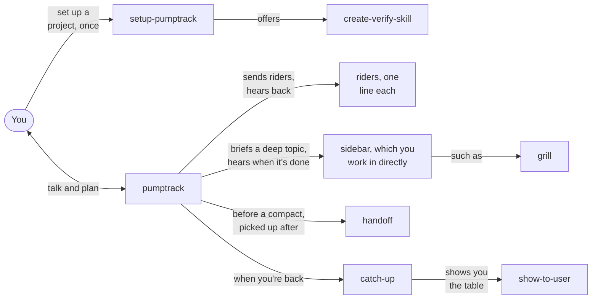
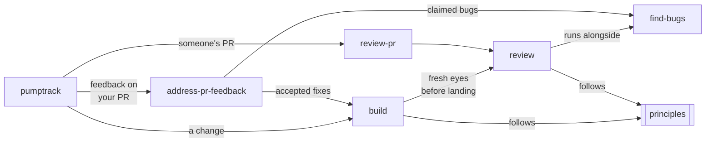
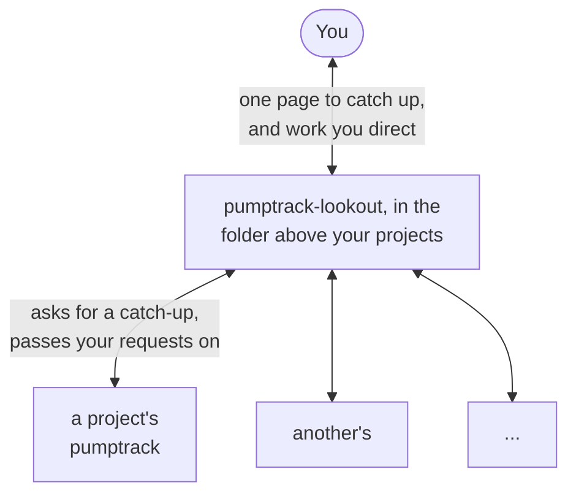

# pumptrack

Agent skills that keep your coding agents moving in rhythm and on track, no pedaling required.

A pump track is a loop of rollers and berms that riders keep moving around without pedaling: they keep their speed by pushing into the terrain at the right moments. pumptrack brings the same idea to agent work. The loop carries itself, and your effort goes into a few well-timed inputs.

## How it works

You talk and plan with `pumptrack`, the agent at the start of every line. It stays light: building, exploring and anything else that would fill its context goes to an agent it sends out, and as they report back it tells you what landed, what's stuck and what needs you. When a topic goes deep, it opens a sidebar, a session you work in directly, which tells it when it's done. Before you compact or clear, a handoff writes down what's still live, and pumptrack picks it up when it starts again. When you come back to a session you've lost track of, `/catch-up` gives you one table of what needs you, what's done, what's in progress, what's waiting on others and what went wrong.

In the pictures, a rider is an agent pumptrack sends out, and a line is the path it takes through the skills, such as build, then review, then a bug check.

A session:

A change goes to a builder, which gathers the requirements, builds in small steps that each end in a check, gets a fresh review before landing, and lands it the way the project lands work. Reviewing someone's PR is the same review, with a thin skill for the GitHub side: it posts the findings you pick in your name, and on a re-review it checks whether your comments were resolved and says whether the PR is ready to approve. When reviewers leave feedback on your own PR, pumptrack goes through it with you and has each accepted fix built. Builders follow the principles, and reviewers use them to keep only the findings that matter.

Landing a change:

From the folder above all your projects, the lookout asks each running session to catch it up and combines the answers on one page you can pin. You can direct work in any project from there too, and it passes that to the project's session.

Across projects:

## The skills

| Skill | What it does | Who calls it |
|---|---|---|
| `pumptrack` | Runs the session as an orchestrator that talks and plans with you while agents do the work | You, to start a session |
| `setup-pumptrack` | Installs the skills and sets a project up: how it runs its checks, where work is tracked, where docs go, how work lands, and your own preferences | You, to set a project up or change its setup |
| `create-verify-skill` | Writes the project a skill that starts its app and drives it the way a user does to prove a change works, with a map of its features, then runs it once | `setup-pumptrack` offers it, or you |
| `build` | Builds a change and lands it: gathers the requirements, builds in checked steps, gets a fresh review, and lands it the way the project does | `pumptrack`, and any skill with a fix to make |
| `review` | Reviews a change against its goal and the principles, and reports only the findings worth acting on | `build` and `review-pr`, or you |
| `find-bugs` | Finds the real bugs in a change, proves each as far as is cheap, and says how sure it is | `review` and `address-pr-feedback`, or you |
| `principles` | The coding principles builders follow and reviewers judge by | `build` and `review` |
| `communication` | How agents talk to you and report back: the outcome first, a "Needs you" list, and your calls left to you | Skills that talk to you or report back, such as `pumptrack`, `build` and `review`, and your own instructions if you point them to it |
| `review-pr` | The GitHub side of reviewing a PR: posts the findings you pick as a pending review in your name, and on a re-review checks whether your comments were resolved | `pumptrack`, or you |
| `address-pr-feedback` | Goes through the open feedback on your PR, plans a fix or a reply for each with you, and has each accepted fix built as its own commit | `pumptrack`, or you |
| `sidebar` | Spins a deep topic off into a fresh session you work in directly, which reports back when it's done | `pumptrack`, and the lookout |
| `grill` | Interviews you about a plan in rounds, each question with a recommended answer, until nothing is open, then writes the plan and its tickets | You, usually in a sidebar |
| `handoff` | Writes a session's live state to a file before a compact or a clear, and picks it up when the session starts again | `pumptrack` |
| `catch-up` | One table of what needs you, what's done, what's in progress, what's waiting on others and what went wrong | You, and the lookout |
| `show-to-user` | Shows you a file, a diff or a report the way you like to see it, asking the first time | Any skill with something for you to read |
| `pumptrack-lookout` | From the folder above your projects, asks each running session for a catch-up, combines them on one page, and passes work you direct to the right session | You |

## Install

pumptrack works with agents that support [Agent Skills](https://agentskills.io/); the examples use Claude Code. `review-pr` and `address-pr-feedback` need the GitHub CLI (`gh`), signed in.

Clone this repo: `git clone https://github.com/brandonbews/pumptrack.git`. Keep the clone if you'd rather link the skills than copy them, so every change reaches every project. A skill added or removed later reaches a project when you run setup there again.

In a project, ask an agent to read `skills/setup-pumptrack/SKILL.md` from the clone and follow it; for Claude Code, that's `claude "Read <clone>/skills/setup-pumptrack/SKILL.md and follow it"`. It asks whether the skills go in the project, committed or kept out of git, or just for you, installs them, and sets the project up, keeping what it finds in notes the project's instructions point to. It's safe to run again. Then start a session with `/pumptrack`.

The lookout goes in the skills folder of the folder that holds your projects, not in any one of them, which is why it sits beside `skills/` as `pumptrack-lookout/`. Setting up offers to put it there. For Claude Code, with your projects in `~/projects`, from the clone: `mkdir -p ~/projects/.claude/skills && ln -s "$PWD/pumptrack-lookout" ~/projects/.claude/skills/pumptrack-lookout`. Then start a session in that folder with `/pumptrack-lookout`.

## License

[MIT](LICENSE).

## Credits

- [pstack](https://github.com/cursor/plugins/tree/main/pstack), by [poteto](https://x.com/poteto): principles as short, named rules agents apply, and the ones `principles` adapts; defaults in the skills with sparse per-project overrides; `create-verification-skill`, the model for `create-verify-skill`, and `setup-pstack`, for ending setup by offering it; `blast-radius`'s scale of how sure a claim is, and its habit of looking where a search stops, for `find-bugs`; `no-comments`, for treating a comment as a sign the code needs rewriting; `tdd`, for `build` writing a failing test first for a bug; and `ketchup`, for `catch-up` starting from the user's last message.
- [skills](https://github.com/mattpocock/skills), by [Matt Pocock](https://github.com/mattpocock): `grill-me` and `grilling`, the base of `grill`, and `grill-with-docs` with `domain-modeling`, for its vocabulary moves and glossary; `setup-matt-pocock-skills`, the model for `setup-pumptrack`, and its prose tracker file other skills defer to; and `implement`, for `build` fetching a ticket given by reference.
- [A Philosophy of Software Design](https://web.stanford.edu/~ouster/cgi-bin/book.php), by John Ousterhout: deep modules, small interfaces that hide real work, in the "easy to follow" principle.
- Studied for how a project's own settings work: [gstack](https://github.com/garrytan/gstack) by Garry Tan, [superpowers](https://github.com/obra/superpowers) by Jesse Vincent, [spec-kit](https://github.com/github/spec-kit) by GitHub, [BMAD](https://github.com/bmad-code-org/BMAD-METHOD) by BMad Code, [Agent OS](https://github.com/buildermethods/agent-os) by Builder Methods, and [OpenSpec](https://github.com/Fission-AI/OpenSpec) by Fission AI.
