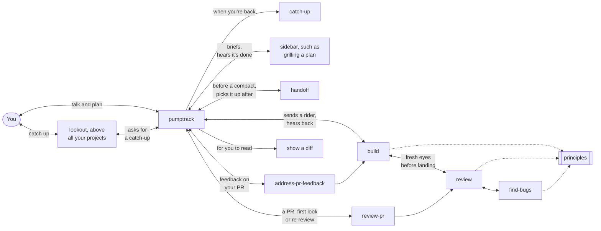
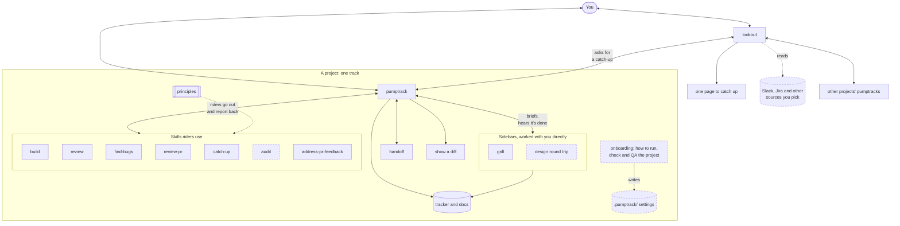

# pumptrack

Agent skills for orchestrating coding agents, so the work keeps moving with as little effort from you as possible.

A pump track is a loop of rollers and banked turns that you ride without pedaling: you keep your speed by pushing into the terrain at the right moments. pumptrack brings the same idea to agent work. The loop carries itself, and your effort goes into a few well-timed inputs.

## How it fits together

🚧 A draft, still being shaped.

The picture is a pump track whose lines branch apart and all come back to the start. It's only for these docs: the skills, and the agent you talk to, use plain words like agent, workflow and project.

| On a pump track | In pumptrack |
|---|---|
| The track | A project with pumptrack installed, along with its config: how it tracks work and how things get done there |
| The start | `pumptrack` itself, the agent you talk to. Every line begins and ends here |
| A line | A path a rider takes through the skills, such as build, then review, then a bug check |
| A rider | An agent pumptrack sends out |
| A run | One rider's trip down one line. A rider comes back, reports, and may go out on another run |
| The lookout | `pumptrack-lookout`, one agent in the folder above all your projects. It asks each pumptrack to catch it up and combines the answers on one page |

### V0.1

A few small skills that call each other, enough to use on real work. Review is one skill whether it checks a builder's change before landing, someone's PR or a re-review; only the context it's given changes. A thin `review-pr` skill handles the GitHub side. On a first review it posts the findings you pick in your name; when you've reviewed before, it checks whether your comments were resolved and says whether the PR is ready to approve. When reviewers leave feedback on your own PR, pumptrack goes through it with you and applies what you accept. It can also open a diff in the viewer you use, for you to read yourself. Builders follow the principles, and reviewers use them to keep only the findings that matter. When a topic goes deep, pumptrack opens a sidebar you work in directly, which tells pumptrack when it's done. Long sessions carry on through compaction. Before you compact or clear, a handoff writes down what's still live, and pumptrack picks it up when it starts again.

When you come back to a session you've lost track of, run `/catch-up`: one table of what needs you, what's done, what's in progress, what's waiting on others and what went wrong. In pumptrack it covers the project, and anywhere else the thread. From the folder above all your projects, the lookout asks each running pumptrack to catch it up and combines the answers on one page you can pin.

### V1

V0.1 plus onboarding, which learns how to run, check and QA the project, and walks you through setting up whatever is missing. Builders also attach screenshots or recordings to a PR when a change is visible and the project allows it.

### Where it's heading

Solid pieces are V0.1. Onboarding comes in V1, and the other dashed pieces after.

## Status

🚧 Just started. Built so far: `pumptrack`, an orchestrator that talks and plans with you while subagents do the work, and `principles`, `build`, `review`, `find-bugs`, `review-pr`, `address-pr-feedback`, `sidebar`, `handoff` and `grill`.

## Install

Ask an agent in your project to clone this repo and copy its `skills/` folder into the project's skills folder (`.claude/skills/` for Claude Code). Then start a session with `/pumptrack`.

To pick up every change in all your projects instead, link each skill into your user skills folder: `ln -s "$PWD/skills/pumptrack" ~/.claude/skills/pumptrack`.

## Private notes

The maintainer keeps the design notes in a private repo, `brandonbews/pumptrack-internal`, cloned into this checkout as `internal/`. This repo ignores `/internal`, and the skills work the same without it. To set up a computer with it:

1. Clone this repo, then the private one inside it: `git clone https://github.com/brandonbews/pumptrack-internal.git internal`.
2. Run `sh internal/scripts/install-hooks.sh`. It installs a `post-checkout` hook that links `internal` into every new worktree. It's safe to rerun, and it refuses to replace a hook it didn't write.

## License

[MIT](LICENSE).
