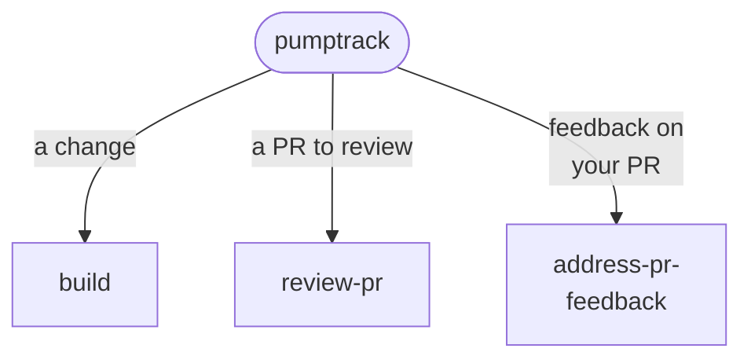
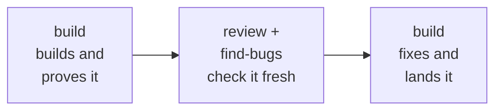
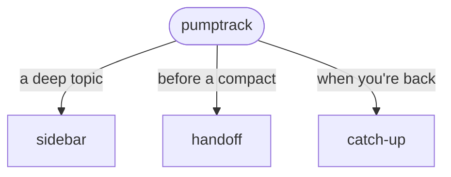
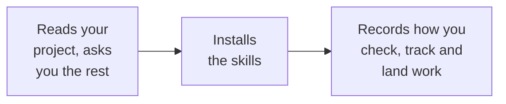

# pumptrack

Agent skills that keep your coding agents moving in rhythm and on track, no pedaling required.

You talk and plan with one agent, `pumptrack`. It sends other agents to build, review and land the work, and tells you what needs you.

A pump track is a loop riders keep moving around without pedaling. Same idea here: the loop carries itself, and your effort goes into a few well-timed inputs.

## How it works

**The work goes out.** `pumptrack` talks and plans with you, and sends an agent for each piece of work.



**A change.** Each build gets a checkout of its own, so builds can run side by side and yours is left alone.



**A long session.** These carry it through a deep topic, a compact and time away.



## Get started

1. Clone this repo:

   ```sh
   git clone https://github.com/brandonbews/pumptrack.git
   ```

2. In your project, have your agent follow the setup skill. With Claude Code, where `<clone>` is the path to your clone:

   ```sh
   claude "Read <clone>/skills/setup-pumptrack/SKILL.md and follow it"
   ```

3. Start a session with `/pumptrack`.

**What setup does,** once per project. It's safe to run again.



Good to know:

- It works with any agent that supports [Agent Skills](https://agentskills.io/). The examples use Claude Code.
- `review-pr` and `address-pr-feedback` need a way to act on GitHub as you, such as the GitHub CLI (`gh`) signed in.
- Setup copies the skills into the project or your own skills folder. Keep the clone to link them instead, so every change reaches every project. Run setup again to pick up a skill added or removed later.
- The deepest chain nests agents four deep: `address-pr-feedback`, `build`, `review`, `find-bugs`. Where a tool caps nesting lower, the steps below the cap run inside their caller instead of with fresh eyes. Claude Code caps it at three unless you raise `CLAUDE_CODE_MAX_SUBAGENT_SPAWN_DEPTH`, and Codex at one by default.

## The skills

Start with `/pumptrack`. Most skills also work on their own, such as `/review` or `/grill`.

| Set up | Once per project |
|:---|:---|
| `setup-pumptrack` | Installs the skills, and records how the project checks, tracks and lands work |
| `create-verify-skill` | Writes a skill that proves a change works in your running app. Setup offers it |

| Session | The skills you work with directly |
|:---|:---|
| `pumptrack` | Talks and plans with you while agents do the work |
| `sidebar` | Moves a deep topic to a session of its own, which you work in directly |
| `grill` | Interviews you about a feature until nothing is open, then writes its tickets |
| `handoff` | Saves what's live before a compact or a clear, and picks it up after |
| `catch-up` | One table of where things stand, starting with what needs you |

| Changes | The agents that build and check a change |
|:---|:---|
| `build` | Builds a change in its own checkout, proves it, gets it reviewed and lands it |
| `review` | Checks a change against its goal and the principles, and reports what matters |
| `find-bugs` | Finds the real bugs in a change, and says how sure it is of each |

| Pull requests | Yours and other people's |
|:---|:---|
| `review-pr` | Reviews a GitHub PR with `review`, and posts the findings you pick in your name |
| `address-pr-feedback` | Goes through the feedback on your PR with you, and has each accepted fix built |

| Ground rules | Used by the other skills |
|:---|:---|
| `principles` | The coding principles builders follow and reviewers judge by |
| `communication` | How agents report: the outcome first, then a "Needs you" list |

## Contributing

Issues and PRs are welcome. [`AGENTS.md`](AGENTS.md) has the project's rules, for you or your agent.

## License

[MIT](LICENSE).

## Credits

- [pstack](https://github.com/cursor/plugins/tree/main/pstack), by [poteto](https://x.com/poteto): principles as short, named rules agents apply, and the ones `principles` adapts; defaults in the skills with sparse per-project overrides; `create-verification-skill`, the model for `create-verify-skill`, and `setup-pstack`, for ending setup by offering it; `blast-radius`'s scale of how sure a claim is, and its habit of looking where a search stops, for `find-bugs`; `no-comments`, for treating a comment as a sign the code needs rewriting; `tdd`, for `build` writing a failing test first for a bug; and `ketchup`, for `catch-up` starting from the user's last message.
- [skills](https://github.com/mattpocock/skills), by [Matt Pocock](https://github.com/mattpocock): `grill-me` and `grilling`, the base of `grill`, and `grill-with-docs` with `domain-modeling`, for its vocabulary moves and glossary; `setup-matt-pocock-skills`, the model for `setup-pumptrack`, and its prose tracker file other skills defer to; and `implement`, for `build` fetching a ticket given by reference.
- [A Philosophy of Software Design](https://web.stanford.edu/~ouster/cgi-bin/book.php), by John Ousterhout: deep modules, small interfaces that hide real work, in the "easy to follow" principle.
- Studied for how a project's own settings work: [gstack](https://github.com/garrytan/gstack) by Garry Tan, [superpowers](https://github.com/obra/superpowers) by Jesse Vincent, [spec-kit](https://github.com/github/spec-kit) by GitHub, [BMAD](https://github.com/bmad-code-org/BMAD-METHOD) by BMad Code, [Agent OS](https://github.com/buildermethods/agent-os) by Builder Methods, and [OpenSpec](https://github.com/Fission-AI/OpenSpec) by Fission AI.
